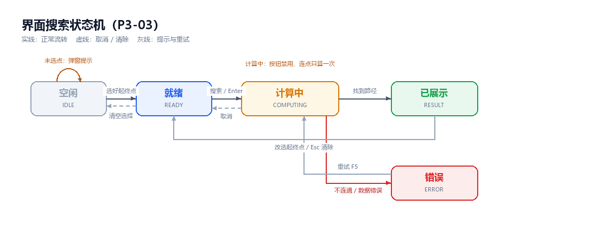
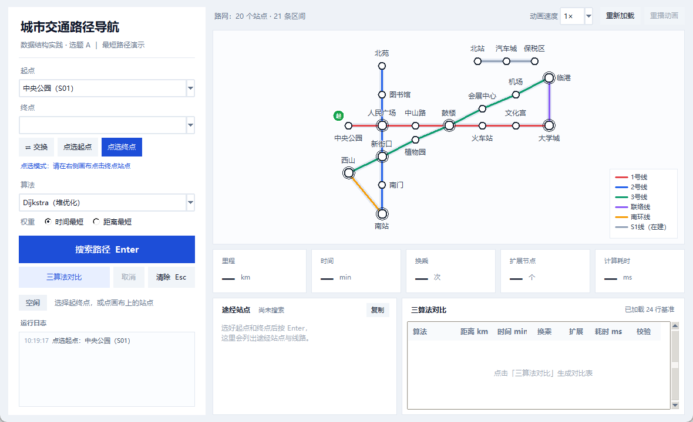
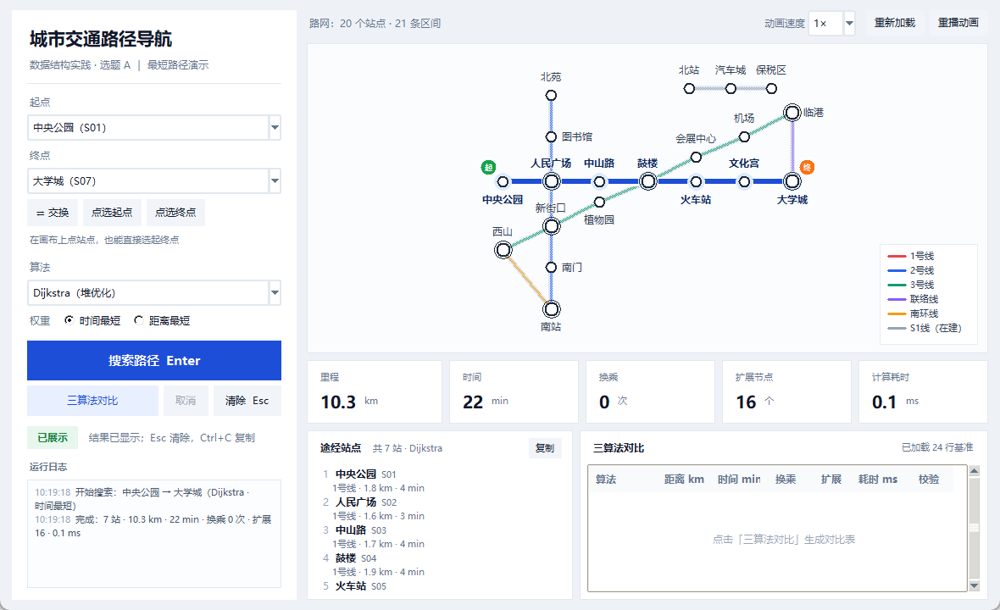
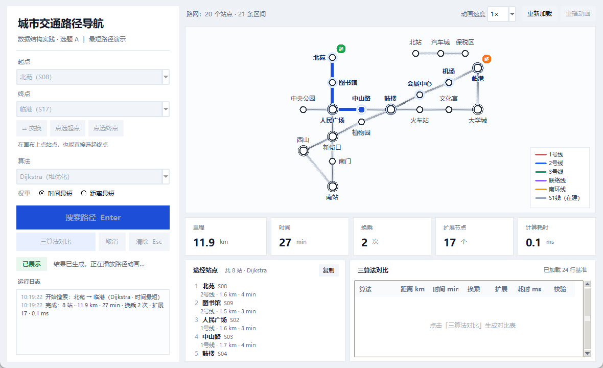
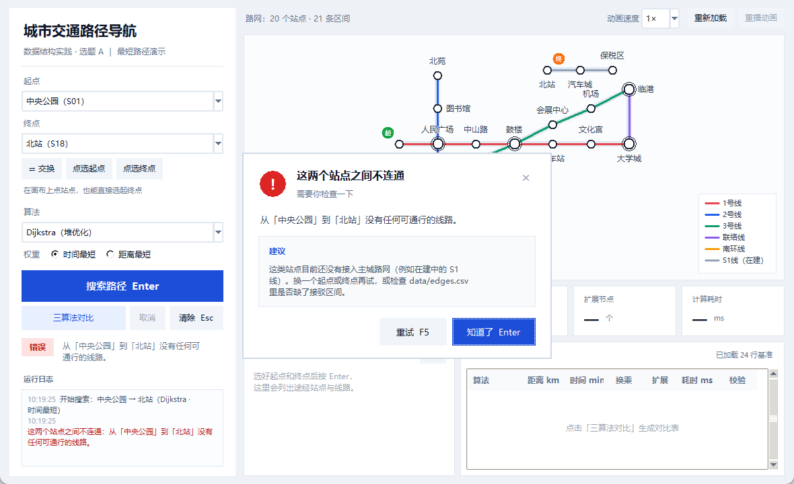
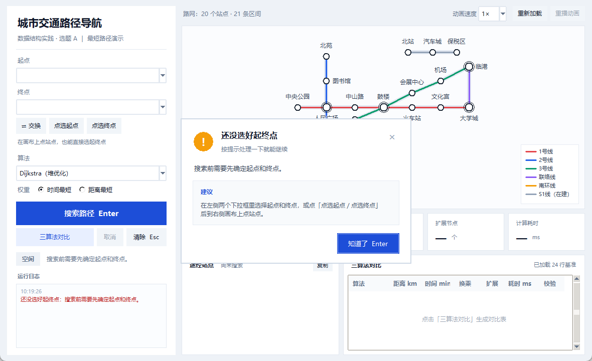
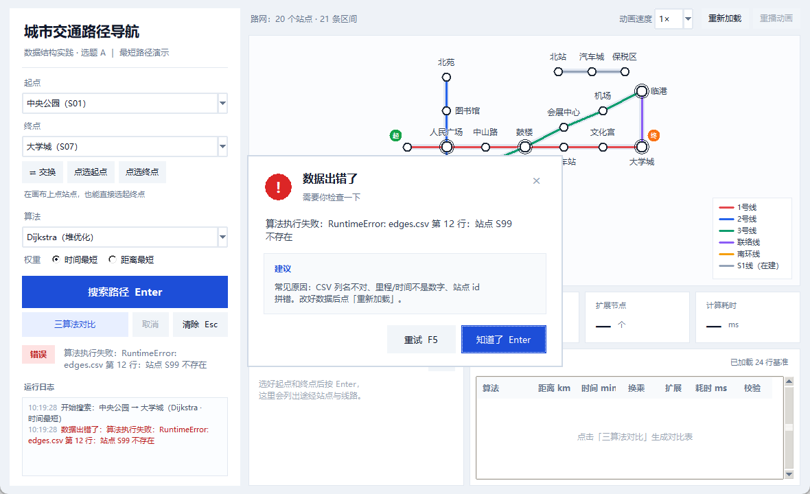
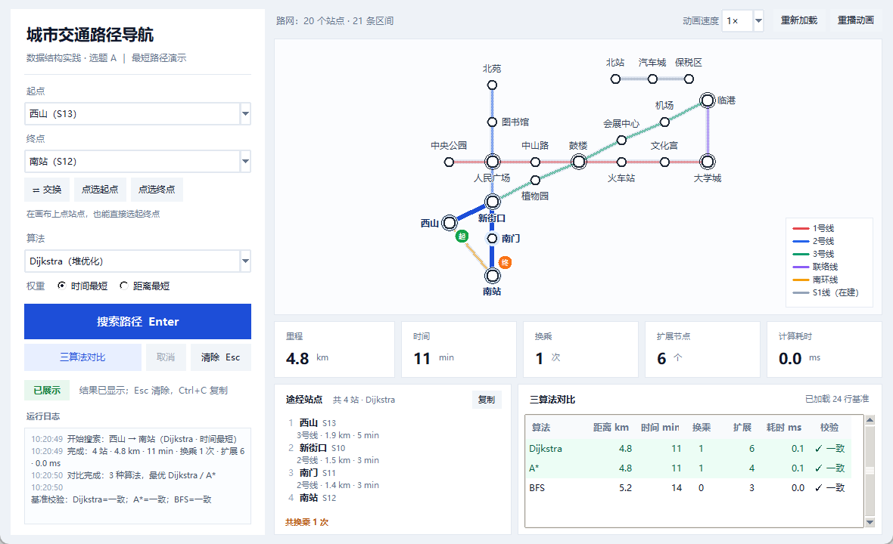

# 第 4 章 系统演示与结果分析（演示部分 · P3 草稿）

> 本文件是 P3 交给 P4 的第 4 章草稿，只覆盖"界面怎么用、长什么样、异常怎么提示"。
> 正确性验证、对比实验的数据与分析由 P4 撰写；图号若与全文章节冲突，请 P4 按终稿重排。
> 所有截图均由 `python tools/shoot.py` 真实运行程序后自动截取，窗口 1180×720。

## 4.1 系统总体界面

程序用 `python main.py` 启动，主窗口 1180×720：左侧 336 px 是起终点与搜索设置，右侧上方是
路网画布，下方依次是五项指标卡、途经站点清单与三算法对比表（图 4-1）。选点与看结果分居左右，
视线往返最短，也避免了"选完再关弹窗"的来回切换。

画布按线路配色：1 号线红、2 号线蓝、3 号线绿、联络线紫、南环线橙、在建 S1 线灰；换乘站画成
双环，右下角有图例。站名用四向描边绘制，线路从字缝中穿过时仍然可读；鼠标移到站点上会出现
虚线框并变成手形光标。示例路网共 20 个站点、21 条区间，其中 S1 线尚未接入主网，专门用来
演示"不连通"这一分支。

指标卡展示里程、时间、换乘、扩展节点与计算耗时，数值直接取自算法返回的 `Result`，界面不参与
计算；站点清单按"序号 + 站名 + ID"逐站列出，并在每个区间下注明"线路 · 里程 · 时间"，超出高度
可滚动。表 4-1 汇总了主要控件。

**表 4-1 界面控件说明**

| 区域 | 控件 | 作用 | 快捷方式 |
| --- | --- | --- | --- |
| 起终点 | 起点 / 终点下拉框 | 以"站名（ID）"选择站点，选中后画布同步显示起终点标记 | `Tab` 切换 |
| 起终点 | 交换 | 起终点对调，方便反向查询 | — |
| 起终点 | 点选起点 / 点选终点 | 进入点选模式后在画布上直接点站；选完自动退出，避免误改 | — |
| 搜索设置 | 算法下拉框 | Dijkstra（堆优化）/ A*（启发式）/ BFS | — |
| 搜索设置 | 权重单选 | 时间最短 / 距离最短 | — |
| 操作 | 搜索路径 | 校验后开始计算，计算中自动禁用 | `Enter` |
| 操作 | 三算法对比 | 一次算出三种算法的三行结果 | — |
| 操作 | 清除 | 清除结果与高亮，保留起终点 | `Esc` |
| 操作 | 取消 | 计算中可中止本次查询 | — |
| 画布 | 动画速度 / 重播动画 | 1×/2×/3× 三档速度，可重播当前结果 | — |
| 画布 | 重新加载 | 数据改动后重新读 `data/`，不需要重启程序 | — |
| 结果 | 指标卡 / 途经站点 / 对比表 | 展示五项指标、站点序列、三算法三行数值 | `Ctrl+C` 复制路径 |
| 底部 | 状态徽标 + 运行日志 | 空闲/就绪/计算中/已展示/错误五态，日志保留操作轨迹 | — |

## 4.2 交互流程

搜索过程被建模为五个状态（图 4-2）：空闲、就绪、计算中、已展示、错误。刚打开时没有选择，处于
"空闲"；起点终点都选好后进入"就绪"，按 `Enter` 或点「搜索路径」开始计算；计算期间除「取消」
外全部禁用；成功进入"已展示"，找不到路径或算法报错则进入"错误"，按 `F5` 重试。

状态机处理了三个容易被忽略的细节：一是**连点**，`begin_search()` 在"计算中"状态下幂等，重复
点击返回同一个 token，不会重复计算，也不会叠加动画；二是**迟到结果**，每次搜索生成新 token，
取消后旧 token 的结果被丢弃；三是**动画期间禁用按钮**，动画由 `after` 定时器逐段推进，播放
结束才恢复，避免两段动画同时播放。

起终点有两条选择路径，两条都通：其一是下拉框，选项统一为"站名（ID）"，读取时用
`rsplit("（", 1)` 取回 ID，避免中文站名被当作键；其二是画布点选，点「点选终点」后按钮变蓝、
提示改为"请在右侧画布点击终点站点"，点中站点即写入下拉框并立即画出橙色"终"标记，点空白处
则不产生任何选择。全流程也可纯键盘完成：`Tab` 依次经过全部控件，`Enter` 搜索，`Esc` 清除，
`Ctrl+C` 复制路径与指标，`F5` 重试。图 4-3 给出了"点选 → 结果 → 动画"的连续三帧。

## 4.3 异常处理

界面把可能打断流程的情况归纳为四类，共用同一套弹窗（图 4-4）。文案遵循"三句话"原则：标题说
现象，正文说原因或影响，建议说下一步怎么做，右下角只保留真正有用的按钮。

1. **不连通**：中央公园到北站（S1 线在建、未接入主网）时提示"这两个站点之间不连通"，正文
   "从「中央公园」到「北站」没有任何可通行的线路"，建议换点或检查 `edges.csv`，可重试。
2. **未选点**：提示"还没选好起终点"，同时给出下拉框与画布点选两种做法；关闭后焦点回到起点
   下拉框，可直接按 `Tab` 继续。
3. **数据错误**：算法或数据层异常统一包装为"数据出错了"，保留原始错误摘要（如"edges.csv 第
   12 行：站点 S99 不存在"），并提示改完后点「重新加载」原地恢复。
4. **空图**：画布显示"暂无路网数据 / 请检查 data/stations.csv 与 data/edges.csv"并弹出提示，
   「重新加载」会重新读取数据目录。

四类异常都保证程序不退出：异常对象继承统一的 `UiError`，携带标题、正文、建议与是否可重试，
界面层只负责选择弹窗样式并记日志。这一设计也直接服务于测试——无窗口环境下即可断言
"未选点抛 `NoSelectionError`、不连通抛 `DisconnectedError`、算法异常变成 `DataError`"。

## 4.4 三算法对比界面

点一次「三算法对比」，界面在同一组起终点与权重下依次调用三种算法，把算法、距离、时间、换乘、
扩展节点、耗时与"校验"并列成三行。校验列把界面数值与 `data/bench.csv` 逐项比较，一致显示
"✓ 一致"、不一致标红；浅绿底的行是当前权重下的最优解，并列最优会同时标出。`bench.csv` 由
同一份 solver 生成、界面又现场重算，两处天然同源，无需手抄。

图 4-5 是"西山 → 南站"的结果：Dijkstra 与 A* 都是 4.8 km、11 min、换乘 1 次，扩展节点分别
为 6 和 4；BFS 走南环线直达，5.2 km、14 min、0 次换乘，只扩展 3 个节点。这说明 A* 在启发函数
可采纳时与 Dijkstra 得到相同最优代价但扩展更少；BFS 只保证区间数最少，可能用更长的乘车时间
换取更少的换乘。对比界面把这种差异直接呈现出来，也为后文 P4 的算法实验提供了可复现的数据。

**表 4-2 三算法对比示例（西山 → 南站，时间权重，摘自 bench.csv）**

| 算法 | 里程 km | 时间 min | 换乘 | 扩展节点 | 与基准校验 |
| --- | --- | --- | --- | --- | --- |
| Dijkstra | 4.8 | 11 | 1 | 6 | ✓ 一致 |
| A* | 4.8 | 11 | 1 | 4 | ✓ 一致 |
| BFS | 5.2 | 14 | 0 | 3 | ✓ 一致 |
