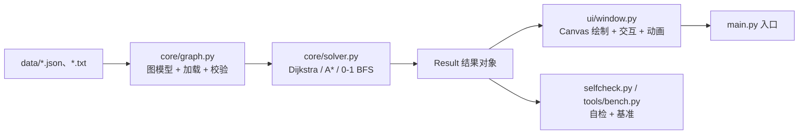

# 技术方案：城市交通路径导航系统

> 数据结构实践 · 选题 A（任务书 PDF 第 1–3 页）｜ 4 人小组 ｜ 方案稿 v0.9 ｜ 2026-10-17
> 对应验收：任务书「5.验收与评价标准」四维（算法实现 / 数据处理 / 界面交互 / 设计报告，P03）
> 阅读顺序：先看 §0 一页速览 → §6 接口契约（跨人协作的关键）→ §7 分工 → §8 进度

---

## 0. 一页速览

| 项 | 内容 |
| --- | --- |
| 交付物 | 可运行的 GUI 程序 + 3 组测试数据 + 实验报告（五章）+ 演示材料 |
| 技术栈 | Python 3.12 + Tkinter（标准库，零第三方依赖）；算法只用 `heapq` / `collections.deque` |
| 架构 | 三层解耦：`core/graph.py`（数据）· `core/solver.py`（算法）· `ui/`（界面），单向依赖 |
| 核心算法 | Dijkstra（时间/距离双权重）· 0-1 BFS（最少换乘）· A\*（欧几里得启发，可采纳性已证） |
| 数据格式 | `.json` 与 `.txt` 两种，**两种格式必须加载出同一张图**（自动化对拍项） |
| 分工 | P1 数据与图模型 · P2 算法引擎 · P3 界面可视化 · P4 集成/验收/报告（兼项目管理） |
| 并行方式 | 先冻结 §6 契约，三人各自用 mock 并行开发；只改自己拥有的文件（§7.1） |
| 验收证据 | `python main.py --check` 全绿 + 手工推导对照表 + 对比实验 CSV + 报告图表 |
| 关键风险 | 真实地图数据来源、A\* 启发函数写错导致非最优、界面阻塞、四人合并冲突 |

**当前基线**：已有参考原型 v0.1（见附录 A），关键路径已跑通、自检全绿；它只作**接口基线**，四人按 §7 分工各自重写/扩展。

---

## 1. 背景与验收口径

### 1.1 任务书要求（摘录，原文见知识库 `任务书原文-2026-10-17`）

- 地图加载：从 `.txt` 或 `.json` 加载站点（坐标、站名）与线路（连接、权重）（P01）。
- 三种搜索：最快路径 = Dijkstra（距离/时间权重）；最少换乘 = BFS（层级搜索）；A\* = 欧几里得启发（P01）。
- 界面：可视化站点网络；下拉菜单**或**点击地图选起终点；高亮路径 + 站点清单（P01–P02）。
- 编程规范：面向对象；Graph / Solver / UI 三者解耦（P02）。
- 报告：五章 + 对比测试表 + 不连通异常展示（P02–P03）。

### 1.2 验收标准 → 证据映射（写报告时逐条对号）

| 任务书维度 | 优秀档要求（P03） | 本项目证据 |
| --- | --- | --- |
| 算法实现 | 三种算法逻辑无误 | `--check` 的 10 组断言 + A\* 与 Dijkstra 全点对同代价 |
| 数据处理 | 真实线路图、支持动态增删 | 加载器支持增删站点/边；提供真实数据适配脚本（§3.4） |
| 界面交互 | 动画演示搜索过程、视觉美观 | 搜索动画（settle 事件逐帧上色）+ 路径高亮 + 图例 |
| 设计报告 | 复杂度分析准确、图表清晰 | §4.4 复杂度表 + 对比实验表 + 甘特式示意 |

### 1.3 范围与非目标

**做**：单城市轨交/公交图、三种搜索、GUI、对比实验、报告。
**不做**（写进报告"局限"）：实时路况、步行接驳、票价与首末班、多用户并发、跨城市。

---

## 2. 总体设计

### 2.1 分层架构



- **依赖方向单向**：`ui → solver → graph`，反向禁止（UI 不得直接算最短路，算法层不得 import tkinter）。
- 数据层不懂算法、算法层不懂界面、界面层不懂图结构细节 —— 这是评分里"面向对象解耦"的实证。

### 2.2 模块与文件所有权（写入范围，避免四人打架）

| 模块 | 文件 | 所有者 | 依赖 |
| --- | --- | --- | --- |
| 数据层 | `core/graph.py`、`data/*`、`tests/test_graph.py` | **P1** | 无 |
| 算法层 | `core/solver.py`、`tests/test_solver.py` | **P2** | P1 的 `Graph` 契约 |
| 界面层 | `ui/window.py`、`ui/canvas.py`、`main.py` | **P3** | P2 的 `Result` 契约 |
| 集成/验收 | `selfcheck.py`、`tools/bench.py`、`README.md`、`docs/*` | **P4** | 全组 |
| 报告 | `report/*.md`（后期转 docx） | P4 主笔，P1–P3 各写自己章节 | — |

> 规则：**只改自己拥有的文件**；需要改别人的接口 → 提"契约变更"（§6.5），由该文件所有者改。

---

## 3. 数据设计

### 3.1 领域模型

```python
@dataclass(frozen=True)
class Station:  sid: str; name: str; x: float; y: float      # 坐标单位 km（平面投影）
@dataclass(frozen=True)
class Edge:     u: str; v: str; line: str; distance_km: float; time_min: float
@dataclass
class Graph:    stations: dict[str, Station]; lines: dict[str, dict]; edges: list[Edge]
                adj: dict[str, list[Edge]]                   # 邻接表：站点 → 边（双向）
```

**为什么邻接表**：城市轨交 `E ≈ 2V`（稀疏），邻接矩阵 `O(V²)` 空间浪费；报告第二章要写这个 `E/V` 算术。

### 3.2 文件格式（两种，语义等价）

**JSON**（推荐给真实数据）：

```json
{
  "meta": { "name": "示例城市" },
  "lines":    [{ "id": "L1", "name": "红线", "speed_kmh": 35, "color": "#e4572e" }],
  "stations": [{ "id": "S1", "name": "中央车站", "x": 0, "y": 0 }],
  "edges":    [{ "u": "S1", "v": "S2", "line": "L1",
                 "distance_km": 2.0, "time_min": 3.43 }]
}
```

**TXT**（便于手改，分节语法）：

```text
[meta]
name=示例城市
[lines]
L1  红线  35  #e4572e
[stations]
S1  中央车站  0  0
[edges]
S1  S2  L1  [distance_km]  [time_min]     # 后两列可省略
```

**缺省规则（关键，跨人一致）**：
1. `distance_km` 省略 ⇒ 按两站坐标欧氏距离计算（`hypot(dx,dy)`，单位 km）；
2. `time_min` 省略 ⇒ `distance_km / speed_kmh * 60`；
3. 两者都给 ⇒ 以文件为准（允许真实线路用时刻表时间覆盖理论值）。

### 3.3 校验规则（加载阶段失败，算法层不再兜底）

| 规则 | 报错 | 谁负责 |
| --- | --- | --- |
| 站点 id 唯一、非空；名称非空 | `DataError("站点 id 重复: S1")` | P1 |
| 边的两端站点存在、非自环 | `DataError("边引用了不存在的站点")` | P1 |
| `distance_km > 0`、`time_min > 0`、有限 | `DataError("距离必须为正")` | P1 |
| 边引用的线路必须已定义 | `DataError("线路未定义: L9")` | P1 |
| 同 `(min(u,v), max(u,v), line)` 不得重复 | `DataError("重复边")` | P1 |
| 不支持的后缀 / 文件不存在 | `DataError(...)` | P1 |

### 3.4 数据集（4 组，覆盖不同测试目的）

| 数据集 | 规模 | 用途 |
| --- | --- | --- |
| `demo_city.*` | 10 站 / 10 边 / 4 线 | 演示 + 自检基线（含"快线 vs 接驳线"多准则差异） |
| `tiny_hand.*` | 3 站 | 手工推导对照（§9.2） |
| `real_metro.*` | ≥100 站 | 真实城市线路（作业优秀档要求；来源见 §12 Q4） |
| `edge_cases.*` | 含孤立站/同城双线/长空档 | 异常与边界测试（§9.4） |

*测试数据要求：至少 3 组不同特点（对应任务书"数据处理"维度）。*

---

## 4. 算法设计

### 4.1 Dijkstra（最快路径，双权重）

```
dist[s]=0；堆 [(0,s)]；done=∅
while 堆非空:
    d,u = pop_min()
    if u in done: continue          # 懒惰删除
    done.add(u); expanded += 1      # 计扩展节点数（报告对比用）
    if u == goal: break
    for (v,w) in adj[u]:
        if d+w < dist[v]: dist[v]=d+w; prev[v]=u; push(d+w, v)
```

- 权重 `w = time_min`（最快）或 `distance_km`（最短）——**同一份数据两种答案**，是本项目的"多准则"抓手。
- 复杂度：`O((V+E) log V)`；空间 `O(V+E)`。
- 非负权重前提：距离/时间都为正 ⇒ 成立（加载阶段已校验 > 0）。

### 4.2 最少换乘 = 0-1 BFS（状态扩展）

**问题**：直接把站点当节点做 BFS，得到的是"最少站数"，不是"最少换乘"。
**建模**：状态 `(站点, 当前线路)`；

- 同线路移动：代价 **0**，入**队首**；
- 站内换线（该站可乘的另一条线）：代价 **1**，入**队尾**；
- 起点：所有经过该站的线路，代价 0 入队；终点：任一线路状态的最小代价。

复杂度：`O(V·L + E)`，`L` 为平均每站线路数（本例 1–2）。路径回溯后把同站换线压成一次站点。

> 报告里要写清"为什么不是普通 BFS"——这是最容易露怯的地方。

### 4.3 A\*（启发式）

`f(n) = g(n) + h(n)`，`h` 取**欧几里得直线距离**：

- 距离权重：`h(n)=‖P_n − P_goal‖`，因边权=实际路径长度 ≥ 直线距离 ⇒ **可采纳**；
- 时间权重：`h(n)=‖P_n − P_goal‖ / v_max × 60`，因 `time = dist/v ≥ dist/v_max` ⇒ **可采纳**；
- **可采纳 ⇒ 最优**：与 Dijkstra 结果必须逐点对一致（§9.1 的对拍项，180 个点对）。
- 若有人把 `h` 换成曼哈顿距离（任务书 Tips 让你对比），在任意方向图上会**高估**、破坏最优性 —— 对比实验正好量化"扩展节点数下降但正确率受损"。

复杂度：最坏 `O(E log V)`，实际取决于 `h` 质量；报告用**扩展节点数**而非仅耗时来体现启发式收益。

### 4.4 复杂度与数据结构口径（报告第三章的核心表）

| 算法 | 时间 | 空间 | 关键结构 |
| --- | --- | --- | --- |
| Dijkstra | `O((V+E)logV)` | `O(V+E)` | 邻接表 + 二叉堆（懒惰删除） |
| 0-1 BFS | `O(V·L+E)` | `O(V·L)` | 双端队列 `deque` |
| A\* | 最坏 `O(E logV)`，实测更小 | `O(V+E)` | 同 Dijkstra + `h` |

> 报告禁止只写"`O(n)`"；必须定义 `V/E`，并按"每操作 × 调用次数"推导（见知识库"数据结构选型与复杂度口径"）。

### 4.5 结果对象（跨层契约）

```python
@dataclass
class Result:
    algorithm: str          # "Dijkstra(time)" / "A*(distance)" / "BFS(最少换乘)"
    found: bool
    path: list[str]         # 站点 id 序列
    distance_km: float
    time_min: float
    transfers: int | None   # BFS 为真实最小换乘；Dijkstra/A* 为沿路径最少切换数（DP 求得）
    expanded: int           # 扩展（settle）节点数
    elapsed_ms: float       # perf_counter 实测
    events: list[tuple[str, str]]   # [("settle", sid), …] 供 UI 动画，算法层不懂界面
```

**注意**：`events` 让界面动画与算法解耦——算法只产出事件序列，UI 负责按帧消费。

---

## 5. 界面设计

### 5.1 布局（1180×720）

```text
┌───────────────────────────────────────────────┬────────────────────────┐
│  线路图例：红线 蓝线 机场快线 接驳线            │ ① 选择起终点            │
│                                               │  起点 [人民广场 ▾]      │
│      ●中央车站────●人民广场────●科技园──●大学城 │  终点 [机场 ▾]          │
│                     │                         │  点选：○起点 ○终点      │
│                  ●河畔──●体育馆──●会展中心      │ ② 算法 [最快·Dijkstra▾] │
│                     │                         │   权重 [时间 ▾]         │
│                  ●北苑──●新城──●机场           │ ③ [搜索动画][立即][对比] │
│                                               │ ④ 结果/日志（Text）      │
└───────────────────────────────────────────────┴────────────────────────┘
```

### 5.2 交互状态机

```
空闲 ──选点(下拉/点击)──► 就绪 ──搜索──► 计算中 ──成功──► 展示(高亮+动画)
                                   └──失败──► 错误弹窗(不连通/数据错误)──► 就绪
展示 ──清除/改参数──► 就绪；展示 ──换算法──► 重算
```

- 点选：`点击站点 → 按当前"点选模式(起点/终点)"写入下拉框`；
- 空态：未选点直接搜索 ⇒ 提示，不崩；
- 异常：不连通 ⇒ `messagebox.showerror` + 日志留痕（任务书明确要求"展示报错处理"）。

### 5.3 视觉规范

| 元素 | 规范 |
| --- | --- |
| 边 | 按线路着色（`lines[].color`），线宽 4；接驳线虚线区分 |
| 站点 | 白底黑边圆点 r=6；站名右侧偏移 (9,-10) |
| 起终点 | 起点绿环、终点红环（r=11，线宽 3） |
| 路径 | 橙色 `#ff7f0e` 粗线宽 7 + 每段标注 `km/min` |
| 动画 | 每帧 90 ms（可配 `--anim-ms`），settle 顺序编号上色 |

### 5.4 "模拟时间"与动画口径（防坑）

- 动画**不得影响结果**：搜索先算完，再播放事件；同一对起终点"动画/立即"必须数值一致（自检项）。
- 不用主线程 `sleep`，一律 `after()` 定时器（任务书 Tips 点名的问题）。
- 窗口尺寸变化触发防抖重绘（否则初始 1×1 时算的坐标会一直用）。

---

## 6. 接口契约（跨人协作的核心）

### 6.1 数据层（P1 提供，P2/P3/P4 使用）

```python
load_graph(path: str | Path) -> Graph        # 后缀分派；失败抛 DataError
Graph.stations: dict[str, Station]
Graph.lines:    dict[str, {"name","speed_kmh","color"}]
Graph.edges:    list[Edge]
Graph.neighbors(sid) -> list[Edge]
Graph.edge_between(u, v) -> list[Edge]
Graph.lines_of_station() -> dict[str, set[str]]
Graph.path_metrics(path, weight) -> (km, min)
Graph.bbox() -> (x0, y0, x1, y1)             # UI 自适应缩放用
```

### 6.2 算法层（P2 提供，P3/P4 使用）

```python
dijkstra(g, start, goal, weight="time"|"distance") -> Result
astar   (g, start, goal, weight) -> Result
bfs_transfers(g, start, goal) -> Result
solve   (g, start, goal, algorithm, weight="time") -> Result   # algorithm ∈ {dijkstra, astar, bfs}
analyze_path(g, path) -> (km, min, line_seq, transfers)
```

异常：`PathNotFound`（不连通）、`DataError`（参数/数据非法）。

### 6.3 界面层（P3 提供，P4 调用做冒烟）

```python
run_gui(graph) -> None
smoke(graph, out_ps: str) -> int      # 建窗→求解→导出画布→销毁，返回码
```

### 6.4 错误约定

| 场景 | 谁抛 | 谁捕获 | 表现 |
| --- | --- | --- | --- |
| 数据文件坏 | `graph.load_*` | `main`/UI | 启动即报错并退出码 2 |
| 两站不连通 | `solver` | UI | 弹窗 + 日志，不退出 |
| 参数非法（算法名/权重） | `solver` | UI/CLI | `DataError`，提示 |

### 6.5 契约变更流程（避免"改一行炸三人"）

1. 提变更：说明**字段/签名/语义**变化与影响面；
2. 版本标记：`CONTRACT_VERSION = "1.2"`（`core/__init__.py`），变更必须 bump；
3. 兼容策略：**只加不改**（新增可选字段/默认参数），破坏性变更需全组同步 + 联调节点验证；
4. 变更记录写进 `docs/契约变更.md`（谁、何时、为什么）。

---

## 7. 分工与协作

### 7.1 四人分工（详见 `docs/任务书/` 四份个人任务书）

| 角色 | 主责（核心工程，不是杂活） | 写入范围（文件所有权） | 点数 | 报告章节 |
| --- | --- | --- | --- | --- |
| **P1 数据与建模** | 双格式加载、校验、4 组数据集、真实数据接入、动态增删 | `core/graph.py`、`data/*`、`tools/import_metro.py`、`tests/test_graph.py` | 14 | 第 1 章（主）+ 第 2 章（主） |
| **P2 算法引擎** | Dijkstra 双权重、A\* 可采纳、0-1 BFS 最少换乘、基准与复杂度 | `core/solver.py`、`tools/bench.py`、`tests/test_solver.py` | 15 | 第 3 章（主）+ 第 2 章供稿 |
| **P3 界面与交互** | 主窗布局、起终点联动、搜索状态机、结果与对比面板、异常空态 | `ui/window.py`、`main.py`、`tests/test_ui.py` | 14 | 第 4 章（演示部分） |
| **P4 渲染与工程化** | Canvas 渲染器（缩放/拖拽/动画时间轴）、导出、自检闸门、打包统稿、录屏 | `ui/canvas.py`、`selfcheck.py`、`tools/export_canvas.py`、`README.md`、`docs/` | 16 | 第 4 章（验证/对比）+ 第 5 章 + 统稿 |

> 合计 **59 点**（1 点 ≈ 0.5 天 ⇒ 29.5 人·天；10 个工作日 × 4 人 = 40 人·天，约 26% buffer）。
> 每人详情（任务编号 / 工时 / 前置 / DoD / 交接 / 坑清单）见 `docs/任务书/P1-数据与建模.md` … `P4-渲染与工程化.md`；
> 共同规则（质量门/泳道/联调/协作/砍需求顺序/接管）见 `docs/任务书/00-总览与协作规则.md`。
### 7.2 关键路径与并行泳道

```
S0 契约冻结 ──► S1 ┌ P1 数据 ─────────────┐
                    ├ P2 算法（mock 图）    ├─► S3 集成 ─► S4 报告/演示
                    ├ P3 界面（假 Result）  │
                    └ P4 自检骨架/基准      ┘
```

- **关键路径**：S0 → P1 → P2 → 集成 → 报告；P3 与 P2 并行（用假 Result）。
- 每日 10 分钟站会：昨天/今天/卡点（三人阻塞就上报）。

### 7.3 分支与提交规范

- 分支：`main`（可运行）← `feat/p1-graph`、`feat/p2-solver`、`feat/p3-ui`、`feat/p4-report`；
- 提交：`<模块>: <做了什么>`（如 `solver: A* 加可采纳性校验`），一次提交只做一件事；
- 合并：只经 P4（或组长）合并；合并前必须 `python main.py --check` 全绿；
- 禁止跨人直接改别人的文件（§2.2）。

### 7.4 三次联调节点（写进进度表）

| 联调 | 内容 | 通过标准 |
| --- | --- | --- |
| J1（S1 末） | 数据层 + 算法层 | `--check` 中数据/算法 6 组断言全绿 |
| J2（S2 末） | 算法 + 界面 | 能点选/搜索/高亮/动画，异常弹窗正确 |
| J3（S3 末） | 全量 + 报告数据 | 对比实验 CSV 出齐，报告图表数据可复现 |

---

## 8. 进度计划（按 2 周估，实际按课程截止缩放）

| 阶段 | 时间 | 产出 | 验收 |
| --- | --- | --- | --- |
| S0 立项 | D1 | 本方案 + 契约冻结（§6）+ 任务书疑点清单 | 四人确认契约与分工 |
| S1 内核 | D2–D4 | 数据层 + 算法层 + 单测 | J1：`--check` 数据/算法项全绿 |
| S2 界面 | D3–D6 | 网络绘制、点选、路径高亮、动画、对比面板 | J2：界面可用 + 截图 |
| S3 集成 | D7–D9 | 三算法对比实验、基准脚本、异常矩阵 | J3：CSV/图表齐全 |
| S4 交付 | D10–D12 | 报告五章、演示录屏、打包提交 | 对照 §1.2 逐条自查 |

> **待确认**：截止时间、是否必须 Python、真实数据来源 —— 见 §12，拿到答案后回填本表日期。

---

## 9. 测试与验收

### 9.1 自动化自检矩阵（`python main.py --check`，退出码即闸门）

| # | 检查项 | 方法 | 期望 |
| --- | --- | --- | --- |
| 1 | JSON/TXT 等价 | 全点对 × 两权重对拍 | 代价逐点相等 |
| 2 | 手算基线 | 3 站小图已知答案 | 6.00 km / 6.00 min |
| 3 | A\* 最优性 | 与 Dijkstra 全点对同代价 | 一致；扩展数 ≤ Dijkstra |
| 4 | 最少换乘 | 与暴力枚举（所有简单路径）对拍 | 逐点对一致 |
| 5 | 多准则差异 | 同一对起终点两种权重 | 路径不同、各有优势 |
| 6 | 起终点相同 | 边界 | 0 km / 0 min / 路径=[起点] |
| 7 | 不连通 | 构造孤立站 | 三算法均抛 `PathNotFound` |
| 8 | 非法数据 | 重复 id / 未定义线路 / 负距离 / 未知站点 | 均抛 `DataError` 且信息非空 |
| 9 | 非法参数 | 未知算法/权重/站点 | 均抛 `DataError` |
| 10 | 界面冒烟 | 建窗→求解→导出画布 | 成功且无异常 |

**判别力要求**：每条断言都必须能在实现出错时失败（禁止恒真断言）；新增功能必须同步新增断言。

### 9.2 正确性验证（报告第四章的"手工推导对照"）

固定小图（3 站，60 km/h）：`A(0,0) B(3,4) C(6,0)`，边 `A-B`、`B-C`、`A-C` = 5/5/6 km。
手算：`A→C` 最短 6 km（直连）6 min；绕行 `A-B-C` 10 km/10 min。
程序输出必须逐项吻合；再接示例城市数据，对照"最快 vs 最短"两条路径。

### 9.3 对比实验设计（报告表格模板）

| 起点-终点 | Dijkstra 耗时 | A\* 耗时 | Dijkstra 扩展 | A\* 扩展 | 路径长度 km | 换乘 |
| --- | --- | --- | --- | --- | --- | --- |
| 大学城 → 机场 | 0.02 ms | 0.02 ms | 10 | 9 | 15.98 / 3.64 | 2 / 0 |

- 至少 5 对起终点（短/中/长/跨线/跨区），每对测 3 次取中位数；
- 附"全部点对"统计（平均扩展节点数、A\* 省下的比例），数据由 `tools/bench.py` 生成 CSV；
- 结论必须写"本数据下"，禁止推广成"某算法永远最优"（任务书口径）。

### 9.4 边界与异常清单（必须覆盖）

空图 / 单站 / 起终点相同 / 不连通 / 孤立站 / 自环 / 重复边 / 未定义线路 / 负距离 / 零时间 /
超大坐标 / 超长站名（UI 不溢出）/ 连续快速点击（动画不叠加）/ 窗口最小化后重绘。

### 9.5 观感验收（"断言全绿 ≠ 画面能看"）

- 交付前必须**真实截图**：主界面 + 搜索结果 + 异常弹窗 + 动画中间帧，共 ≥4 张；
- 截图判据：站名不重叠、路径线不遮挡站名、控件不被裁切、图例完整；
- 截图与录屏一起进演示材料。

---

## 10. 风险与应对

| # | 风险 | 影响 | 应对 |
| --- | --- | --- | --- |
| R1 | 真实线路数据难找/有版权 | 数据处理维度扣分 | 优先公开数据（如公开的地铁里程/站点表），自建 30–100 站规模；报告注明来源 |
| R2 | A\* 启发函数写错（用曼哈顿或忘除速度） | 非最优，算法维度重伤 | §9.1 第 3 项必须是"全点对同代价"；只在对比实验里故意用错版 |
| R3 | 界面动画阻塞主线程 | 卡顿、暂停失灵 | 一律 `after()`；算法先算完再播放事件 |
| R4 | 四人并行合并冲突 | 集成期返工 | §2.2 文件所有权 + §6.5 契约变更流程 + 每日合并 |
| R5 | "最少换乘"做成"最少站数" | 概念性错误 | §4.2 的状态建模写进报告，并用手算例子验证 |
| R6 | 性能测噪声（ms 波动） | 对比表不可信 | `perf_counter` + 多次取中位数 + 大图（≥100 站）才谈 ms |
| R7 | 任务书 PDF 表格被裁切/公式未渲染 | 漏要求 | 以知识库整理版为准（`任务书原文-2026-10-17`），疑点走 §12 |

---

## 11. 交付物与目录结构

```text
数据结构实践-A-路径导航/
├─ main.py                 # 入口：GUI / --check / --cli / --smoke
├─ selfcheck.py            # 自检矩阵（退出码即闸门）
├─ core/{graph.py,solver.py,__init__.py}
├─ ui/{window.py,canvas.py,__init__.py}
├─ data/{demo_city.*, tiny_hand.*, real_metro.*, edge_cases.*}
├─ tests/{test_graph.py, test_solver.py}
├─ tools/{bench.py, plot.py}
├─ docs/{技术方案.md, 契约变更.md, 截图/}
├─ report/{01-需求建模.md … 05-总结.md}  → 最终 docx
└─ README.md               # 安装、运行、数据格式、自检、常见问题
```

**提交清单**（对照任务书）：源码 + 依赖说明 · 运行说明 · ≥3 组数据 · 报告五章 · 演示材料（截图/录屏）。

---

## 12. 待确认问题（组内/老师）

| # | 问题 | 影响 |
| --- | --- | --- |
| Q1 | 截止时间与提交方式（平台/邮箱）？ | 进度表回填 |
| Q2 | 语言是否限 Python？（任务书写"Python 或 C++"） | 技术栈 |
| Q3 | 是否要求"动画演示搜索过程"作为必做（还是优秀档加分）？ | P3 工作量 |
| Q4 | 真实线路数据是否需要、来源是否受限？ | 数据集与报告 |
| Q5 | 四人各自可投入时间？ | 分工再平衡 |
| Q6 | 报告是否必须 docx/pdf、有无格式模板？ | 交付形态 |

---

## 附录 A：参考原型 v0.1 现状（已验证，可作接口基线）

- 已有文件：`main.py`、`core/graph.py`、`core/solver.py`、`ui/window.py`、`selfcheck.py`、`data/demo_city.{json,txt}`、`_smoke_shot.py`。
- 实测结论（2026-10-17）：
  - `python main.py --check` → **ALL PASS**（10 组断言：格式等价、手算基线、A\* 全点对同代价、BFS 与暴力枚举一致、多准则差异、边界与异常）；
  - A\* 与 Dijkstra 在 180 个（点对 × 权重）上代价完全一致，A\* 扩展节点数 180/180 不多于 Dijkstra；
  - 示例城市"大学城→机场"：最快 15.98 km/17.88 min（2 次换乘）vs 最短 3.64 km/21.84 min（0 次换乘）——多准则差异可复现；
  - GUI 冒烟可建窗、求解、导出画布（22 KB PostScript）。
- 该原型的价值：**契约签名已被真实运行验证**，四人可直接沿用 §6 的接口，不必从零商量。

## 附录 B：任务书原文锚点（知识库）

`[[任务书原文-2026-10-17#P01]]` 背景/目标/3.1 · `#P02` 3.2 编程规范与报告第一章/第二章 · `#P03` 验收标准与 Tips。
知识库路径：`D:\memory\数据结构实践\`（检索：`python "D:\memory\数据结构实践\_scripts\kb_find.py" "Dijkstra"`）。