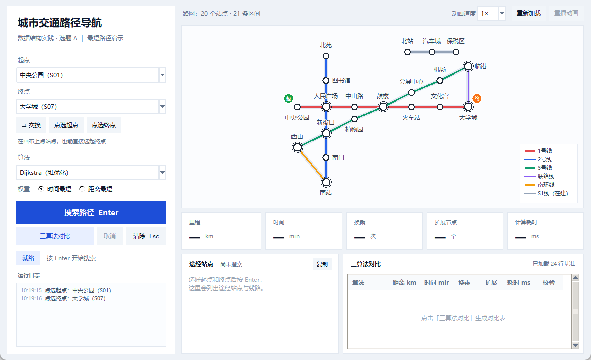

# 城市交通路径导航系统（数据结构实践 · 选题 A）

以"站点 + 区间"为模型的城市轨道交通最短路查询程序：左侧选起终点、右侧看路网，
支持 Dijkstra / A* / BFS 三种算法、时间/距离两种权重、路径高亮动画与三算法对比。

本仓库当前由 **P3（界面与交互）** 交付；P1（数据加载）、P2（算法）、P4（画布渲染）
的接口已按任务书冻结，仓库里放的是**可运行的契约桩**，真实现到位后直接替换即可，
界面层不需要改动。

## 快速开始

```powershell
python main.py            # 打开界面（1180×720）
python main.py --check    # 11 项自检，全绿才算通过
python -m unittest tests.test_ui -v    # 交互层 18 条用例
```

演示用的两个启动参数：

```powershell
python main.py --empty                          # 强制空图，看空态提示
python main.py --data tests/fixtures/broken     # 坏数据，看"数据错误"提示
```

## 目录

```
main.py                 入口 + --check 自检
core/graph.py           图数据层（P1 契约桩：load_graph / Graph / Station / Edge）
core/solver.py          最短路求解（P2 契约桩：solve / Result）
ui/window.py            P3 主窗：布局、状态机、结果面板、异常与快捷键
ui/widgets.py           P3 自绘控件：扁平按钮、统一提示弹窗
ui/canvas.py            画布渲染（P4 契约桩：CanvasView）
data/                   stations.csv / edges.csv / bench.csv
tests/test_ui.py        交互层单测（假 solver 驱动，不弹窗口）
tools/make_bench.py     由 solver 生成 bench.csv（禁止手抄）
tools/shoot.py          自动截图（把 9 张界面图跑出来）
tools/draw_state_machine.py  报告用状态机图
docs/                   交付说明、报告第 4 章草稿、截图
```

## 界面速览



| 操作 | 方式 |
| --- | --- |
| 选起点 / 终点 | 下拉框，或在画布上点站点 |
| 搜索 | `Enter` 或「搜索路径」 |
| 清除结果 | `Esc` |
| 复制路径 | `Ctrl+C` |
| 失败重试 | `F5` |
| 切算法 / 权重 | 左侧下拉与单选 |

## 数据约定

* `data/stations.csv`：`id,name,x,y,lines`（`x/y` 为平面示意坐标，`lines` 用 `|` 分隔）
* `data/edges.csv`：`from,to,line,km,min`（一行 = 一条双向区间）
* `data/bench.csv`：`python tools/make_bench.py` 生成，界面与报告共用这一份

换一套路网只要替换前两个 CSV，界面与自检会自动跟着变（站点 id 建议保持 `S01` 这种短 id）。

## 交付文档

* [P3-交付说明](docs/P3-交付说明.md)：任务逐条对照、接口契约、已知限制
* [报告第 4 章草稿](docs/第4章-系统演示与结果分析-P3草稿.md)：演示部分约 1500 字（另附表 4-1、4-2）
* [截图与图注](docs/截图/README.md)
